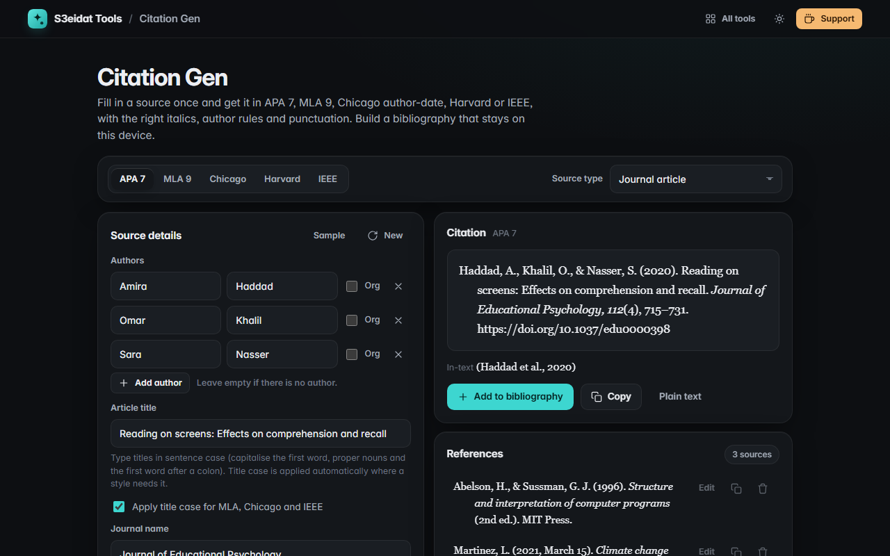

# Citation Gen

> APA 7, MLA 9, Chicago author-date, Harvard and IEEE citations and bibliographies. Free, private, and it runs entirely in your browser.

### ▶ [Open Citation Gen](https://s3eidat.github.io/citation-gen/)



## Features

- **Five styles**: APA 7th, MLA 9th, Chicago 17th author-date, Harvard (Cite Them Right) and IEEE
- **Seven source types**: book, chapter in an edited book, journal article, web page, newspaper or magazine article, online video, report
- **Author rules per style**: APA `&` and the 21+ author rule, MLA `et al.` from three authors, Chicago's ten-author rule, Harvard `et al.` from four, IEEE `et al.` from seven; organisations as authors
- Correct **italics**, quotation marks, initials (`J.-P.`), editions (`2nd ed.` / `2nd edn.`), DOIs as `https://doi.org/…`, MLA's shortened page ranges (`127-53`) and month abbreviations
- **Title case** applied for MLA, Chicago and IEEE (type titles in sentence case for APA and Harvard); you can switch it off
- **In-text citation** for each style, e.g. `(Abelson & Sussman, 1996)` or `[3]`
- **Bibliography**: add, edit, delete; sorted alphabetically, or numbered in citation order for IEEE; saved on this device
- **Copy with formatting** (italics kept when pasting into Word or Google Docs), copy as plain text, or export a `.txt`

The formats are checked by a built-in self-test against fixed examples (a two-author book, a web page, a three-author journal article) in all five styles.
Citation rules have many edge cases; check unusual sources against your style guide or your instructor's requirements.

## Privacy

Your sources never leave your device. There is no server, no account, no analytics.
The page ships with a strict Content-Security-Policy (`connect-src 'self'`), so the browser
itself blocks any attempt to send data anywhere. The bibliography is kept in your browser's local storage;
**Clear** removes it.

## Run it yourself

It's plain HTML, CSS and JavaScript with no build step:

```bash
git clone https://github.com/s3eidat/citation-gen
cd citation-gen
python -m http.server 8000
```

Then open http://localhost:8000.

## Support

If this saved you time, **[buy me a coffee ☕](https://s3eidat.github.io/coffee/)**. It keeps every tool free.

---

Part of **[S3eidat Tools](https://s3eidat.github.io/)**: 100+ free, private tools that run in your browser. MIT licensed.
